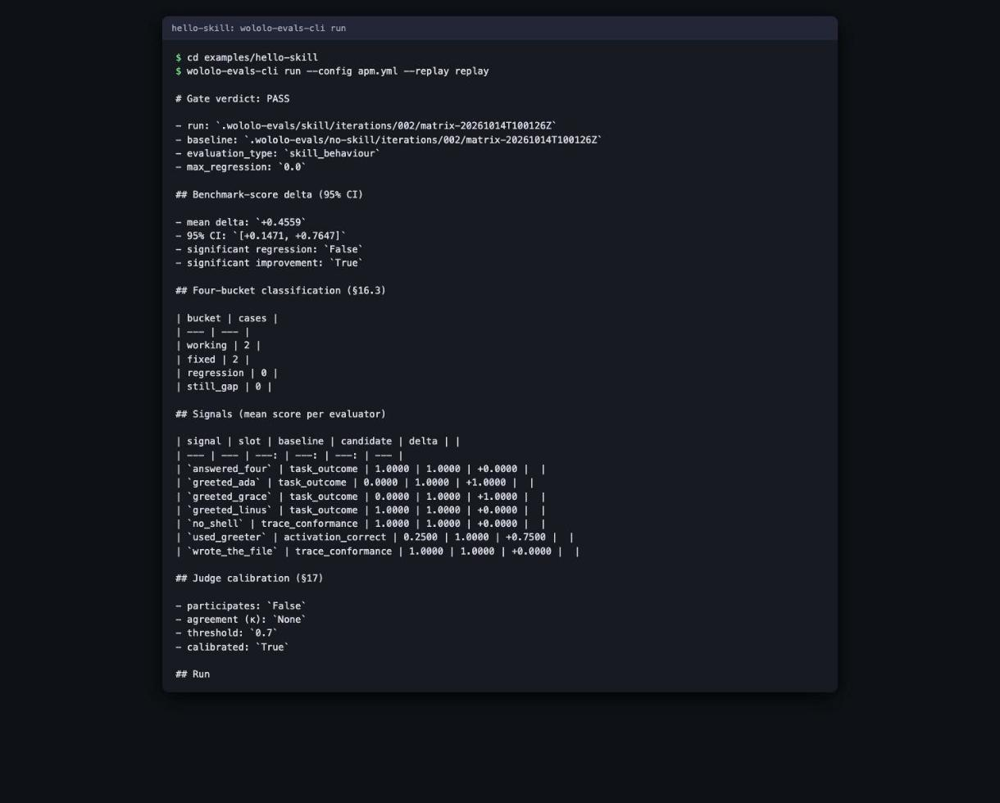

# wololo-evals

[](LICENSE)

Scores an agent asset against a no-skill baseline and gates on the difference.

- Works on an agent skill, agent, prompt or tool: the same asset is run with and without it.
- The gate is statistical (paired bootstrap), so you learn whether the asset helps, not just whether it runs.
- The verdict is `pass`, `regression` or `refused`, and the exit code is `0`, `1` or `2`.
- The result is one `eval-gate-report.json`. Other tools can read it, for example the Backstage hub
  [wololo-labs/skillshub-backstage](https://github.com/wololo-labs/skillshub-backstage).
  wololo-evals knows nothing about that hub; the file shape is the only contract.

Alpha software.



*`wololo-evals-cli run` on [`examples/hello-skill`](examples/hello-skill). This is a replay run: it scores
recorded runs and spends nothing. Those recordings are hand-authored, not captured from a model, so the
`PASS` shows the gate working, not that a real skill helps.*

## Where the result shows up


*The Backstage plugin from [wololo-labs/skillshub-backstage](https://github.com/wololo-labs/skillshub-backstage),
showing `test-writer-pack` from the public
[stevengonsalvez/ainb-toolkit](https://github.com/stevengonsalvez/ainb-toolkit) repo. The hub reports
"No measured gain over the gate's baseline".*


*Same plugin and repo, further down the page: the eval score read from the gate report. The change versus
baseline is +0.0003 with a 95% interval of -0.0102 to 0.0105, so this pack shows no measured gain.*

## Quick start

Zero-spend replay of the bundled example. Needs Python 3.11 or newer.

```console
pip install .
cd examples/hello-skill
wololo-evals-cli run --config apm.yml --replay replay
```

It prints the verdict, writes `eval-gate-report.json` and `eval-gate-report.md` next to `apm.yml`, and exits
`0` (`pass`). `1` means the skill arm regressed against the no-skill arm; `2` means the run was refused, for
example a missing cost cap or too few cases.

## Run it locally

- **Replay (free, offline):** the Quick start above. `pip install .`, then `wololo-evals-cli run --config apm.yml --replay replay` in `examples/hello-skill`. Needs only Python 3.11+.
- **Live on your own skill:** `cp -r examples/hello-skill my-eval`, put your skill under `skill/`, and edit the `eval:` block in `apm.yml`.
- **Live needs:** the `claude` CLI on your PATH (2.0.24 or newer) and signed in, and a `max_cost_usd` cap. The run refuses without one.
- **Model name:** the `claude` engine only accepts models on its allow-list (`claude-opus-5`, `claude-sonnet-5`, `claude-opus-4-7`, `claude-opus-4-6`, `claude-sonnet-4-6`, `claude-haiku-4-5`). Any other name fails before a case runs.
- **Run it:** drop `--replay replay`, `wololo-evals-cli run --config apm.yml`. Exit `0` pass, `1` regression, `2` refused.
- **See it in the hub:** commit `eval-gate-report.json` next to your `apm.yml`; the Backstage skill hub reads it (see [skillshub-backstage](https://github.com/wololo-labs/skillshub-backstage)).

## The `eval:` block

Declare the evaluation once, in the pack's `apm.yml`:

```yaml
eval:
  asset: skill              # relative to apm.yml; optional if the pack has one skill
  benchmark: benchmark      # a directory with benchmark.json, or a built-in name
  engine: claude
  model: claude-sonnet-5
  max_cost_usd: 1.00        # a live run refuses without a cap
  thresholds: { pass: 0.7, max_regression: 0.0 }
  report: eval-gate-report.json   # optional; default beside apm.yml
```

The keys that matter: `asset` (what is tested), `benchmark` (the cases), `engine` and `model` (what runs
them), `max_cost_usd` (the spend cap) and `thresholds` (`pass` is the floor the skill arm's score must reach;
`max_regression` is the tolerated drop). Unknown or missing keys are refused by name. The measured result is
never written into the manifest. A standalone `eval.yaml` (the same keys at the top level) is still read, with
a deprecation notice; an `eval:` block in a sibling `apm.yml` wins over it.

## GitHub Action

```yaml
- uses: wololo-labs/wololo-evals@main
  with:
    config: apm.yml        # default
    replay: replay         # recorded archive scored on pull requests, at zero spend
    # max-cost-usd: "1.00" # workflow_dispatch only: overrides max_cost_usd
```

Outputs `verdict` and `report`. It uploads the report and fails the job on a regression or a refusal. On
`workflow_dispatch` it runs live under the cost cap and uploads a replay archive to commit for the next pull
request. Any other event without `replay` is refused.

---

## Details

### Engines

`claude`, `codex` and `copilot` run live; `replay` scores a recorded archive (`ARCHIVE/no-skill` and
`ARCHIVE/skill`) with no engine and no spend. After a live run, `run --record DIR` writes both arms as an
archive that `--replay` can score later. `run` also takes `--engine`, `--model`, `--benchmark`,
`--max-cost-usd`, `--max-regression` and `--out` (default `.wololo-evals` beside the config) to override the
config.

The LLM judge for plain-text assertions is off by default and is the only part that spends money on its own:
enable it with `--judge on` or `WOLOLO_EVALS_JUDGE=on` (judge model: `WOLOLO_EVALS_JUDGE_MODEL`).

### Commands

| Command | Does |
|---|---|
| `run` | evaluate a skill from the `eval:` block: no-skill arm, skill arm, gate |
| `gate` | candidate-vs-baseline verdict from two existing matrix run directories |
| `matrix` | expand and run a matrix config; `--dry-run`, `--smoke`, `--max-cost-usd`, `--iteration` |
| `bench` | run one benchmark as a single combo |
| `replay` | re-score an archived matrix run, zero spend |
| `cases` | case authoring; `cases compile` turns `cases.toml` into `cases.jsonl` |
| `label` | record a human verdict into `labels.jsonl` |
| `judge` | judge governance, including calibration against a golden set |

### The gate

`gate` fails (exit `1`) when:

- the upper bound of the paired-bootstrap confidence interval of the benchmark-score delta is below
  `-max_regression` (a significant regression);
- any case newly trips a hard gate, regardless of significance;
- a signal named with `--signal-guard EVALUATOR_ID` (repeatable) scored lower than on the baseline. A
  composite can improve while one measure that matters slips; a guard pins that measure.

It refuses (exit `2`) a run flagged `judge_disabled`, a benchmark whose judge is uncalibrated, a run that
omits baseline cases (unless `--allow-subset`), a run whose trace skipped unrecognised event types (unless
`--allow-skipped-trace`), and a verdict over fewer than `--min-cases` comparable cases (default 3). Quarantined
cases are left out of the verdict and reported as such. Every signal present in both runs is reported with
baseline mean, candidate mean and delta, guarded or not.

Bootstrap settings: `--confidence` (default `0.95`), `--resamples` (default `1000`), `--seed` (default `0`).
Judge agreement: `--golden-agreement` injects a value, `--judge-agreement-min` sets the floor (default `0.7`).
Thresholds: `--max-regression` (default `0`); in `run` they come from `thresholds` in the `eval:` block.
Provenance for a catalogue can be recorded with `--subject-repo`, `--subject-path`, `--subject-commit`,
`--source`, `--source-visibility` and `--recorded`.

Try the gate on a bundled regression example. It exits `1` on purpose:

```console
wololo-evals-cli gate \
  --run examples/runs/dropdowns-synthetic/candidate-v2 \
  --baseline examples/runs/dropdowns-synthetic/baseline-v1 \
  --benchmark examples/runs/dropdowns-synthetic/benchmark \
  --golden-agreement 1.0
```

### The report

`eval-gate-report.json` is a frozen v1 contract: [`specs/eval-gate-report`](specs/eval-gate-report) holds the
JSON Schema, field semantics and test vectors. Consumers validate against the schema and do not import
wololo-evals. See also `specs/eval-candidate`, `specs/eval-result` and `specs/identity`.

### Layout

| Path | Contents |
|---|---|
| `src/wololo_evals/` | CLI, gate and stats core, engine adapters, trace normaliser, scoring, API service |
| `examples/hello-skill/` | smallest complete skill evaluation, offline |
| `examples/runs/` | recorded runs for `gate`; `examples/fixtures/` holds fixture services |
| `benchmarks/` | built-in benchmarks, resolvable by name |
| `docs/` | adversarial-verify record, QE casebook design |
| `specs/` | published contracts |

### Status

The offline replay and gate paths are covered by automated tests. Live model runs, external identity issuers
and deployment integrations require local configuration and are not exercised by the default test suite.

### Development

```console
python3 -m venv .venv
. .venv/bin/activate
pip install -e '.[dev]'
pytest
```

Some integration tests need Docker or externally configured credentials and skip when those prerequisites are
unavailable.

The Compose stack requires an issuer JWKS and issuer identifier. Set `WOLOLO_EVALS_JWKS` to a local public
JWKS file and `WOLOLO_EVALS_ISSUER` to its issuer identifier before running `docker compose up`. The file is
mounted read-only into the API and worker containers. No private signing key ships with this repository.

### Security

Use GitHub's private vulnerability reporting for security reports. Do not open a public issue containing a
credential or sensitive evaluation data.

### Contributing

See [CONTRIBUTING.md](CONTRIBUTING.md).

### License

Copyright 2026 Steven Gonsalvez. Licensed under the [Apache License, Version 2.0](LICENSE).
